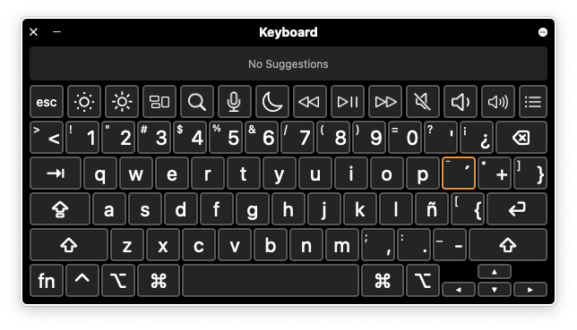
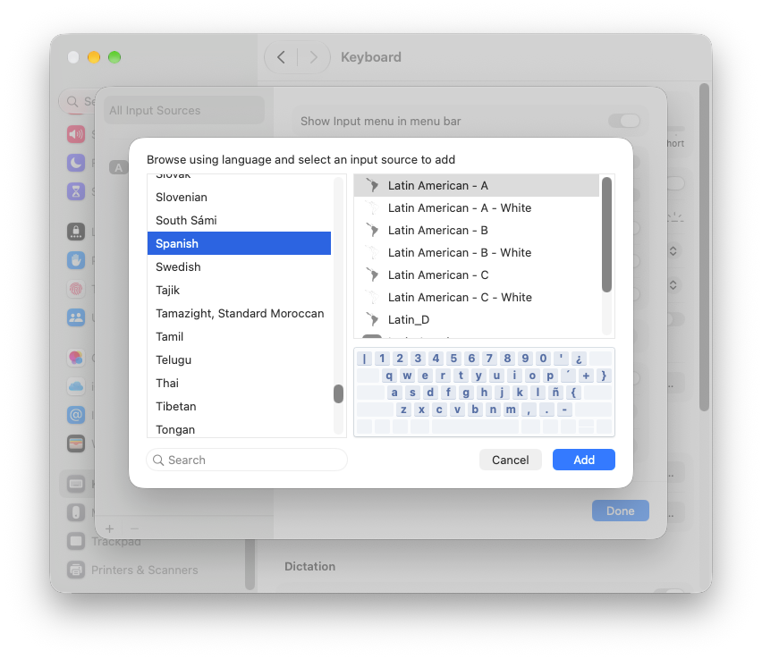
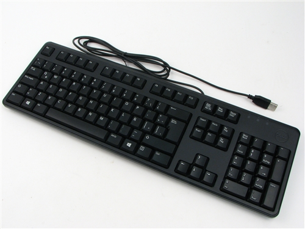
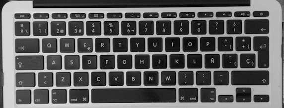
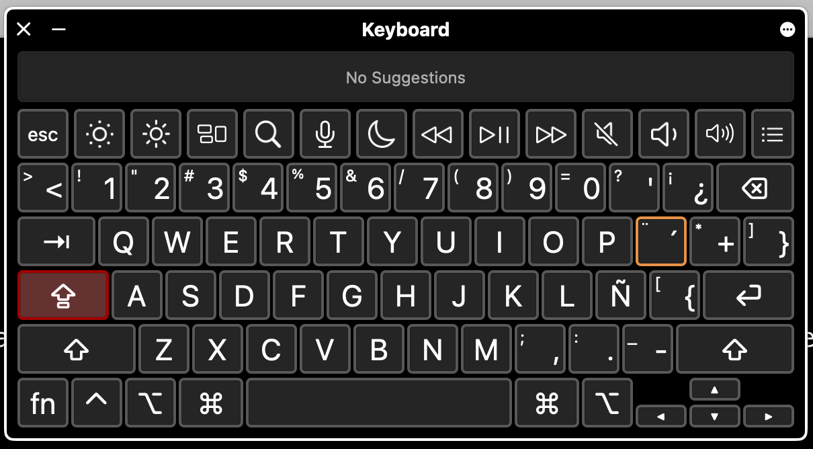
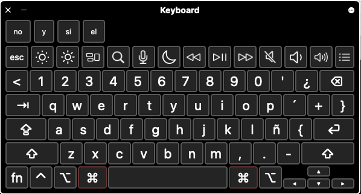
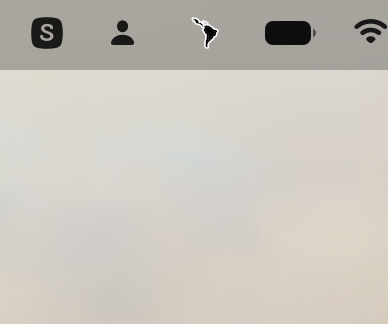
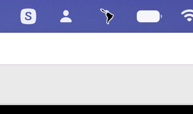

# Latam-Keyboard

macOS keyboard layouts for Latin American keyboards.

Apple's own Latin American layout doesn't match many of these keyboards. For example, `<` and `>` often end up on the wrong key on external keyboards. These layouts follow the labels on the keys, keep the layout's own characters for shortcuts like Cmd+`+`, and tell macOS they're for Spanish.



## Install

Install with [Homebrew](https://brew.sh):

```
brew install --cask neosergio/tap/latam-keyboard
```

Homebrew will ask for your password, because the layouts are installed for all users in `/Library/Keyboard Layouts`.

Log out and back in, then go to **System Settings > Keyboard > Input Sources > Edit > +**. The layouts are listed under **Spanish**, or you can search for "Latin American". Because they're marked as Spanish, apps like Word check spelling in Spanish while you type with them.



To update to a new version:

```
brew upgrade --cask latam-keyboard
```

### Upgrading to version 1.2.0 from Type D or a White version

Version 1.2.0 removed Type D and the _White_ versions of Types A, B and C. Type D had become the same as Type A, and the White versions' fixed white icon was replaced by an icon that works on any menu bar. After `brew upgrade`, those layouts disappear from Input Sources. Add the regular layout instead: Type A instead of Type D, or the same type without "White".

### Upgrading from version 1.0.x

Version 1.1.0 changed how the layouts are packaged, and macOS sees them as new layouts. After `brew upgrade`, remove the old Latin American layouts from **System Settings > Keyboard > Input Sources**, log out and back in, and add them again.

### Upgrading from a manual install

Earlier versions of this README said to copy the files into `~/Library/Keyboard Layouts` by hand. If you did that, remove those copies before or after installing with Homebrew, so that each layout shows up only once:

```
rm ~/Library/Keyboard\ Layouts/Latam_*
```

## Uninstall

1. Remove the layout from **System Settings > Keyboard > Input Sources**.
2. Run `brew uninstall --cask latam-keyboard`.
3. Log out and back in.

## Which layout to choose

**There are several versions. Try them and choose the one that works for you.** The main difference between them is which key types `<` and which types `|`. To see what each key types, choose **Show Keyboard Viewer** from the input menu in the menu bar.

- _**Type A**_: frequently used with external keyboards. `<` is next to the left Shift key, and `|` is below Esc.

  

- _**Type B**_: frequently used with built-in Mac keyboards. `|` is next to the left Shift key, and `<` is below Esc.

  

- _**Type C**_: for some gaming keyboards. It types the same as Type B, except that with Shift those two keys give `>` and `°` the other way around, to match how those keyboards are labeled.

Caps Lock only changes letters, including `Ñ`. The other keys keep their characters:



With Command held, every key keeps its character, so shortcuts like Cmd+`+` and Cmd+`-` use the keys as labeled:



The orange outline on the `´` key in Keyboard Viewer isn't a stuck key. It marks an accent (dead) key: it types nothing on its own and adds the accent to the next letter, so `´` then `a` gives `á`. With Command held it types `´` directly, so it isn't outlined.

### The icon

The icon is a black continent with a thin white outline, so it stays visible over any menu bar color. That matters since macOS 26, where the menu bar is transparent and its color depends on your wallpaper, not on light or dark mode.

| Light wallpaper | Dark wallpaper |
|---|---|
|  |  |

It also shows up in the badge next to the text cursor when you switch layouts:


## Contribute

Feel free to contribute, adapt or improve these layouts and share them with the community.

Before sending a pull request, run `tests/run.sh`. It checks every layout through macOS itself, including what the keys type, without needing a Latin American keyboard or a logout. You need Xcode or the Command Line Tools.
